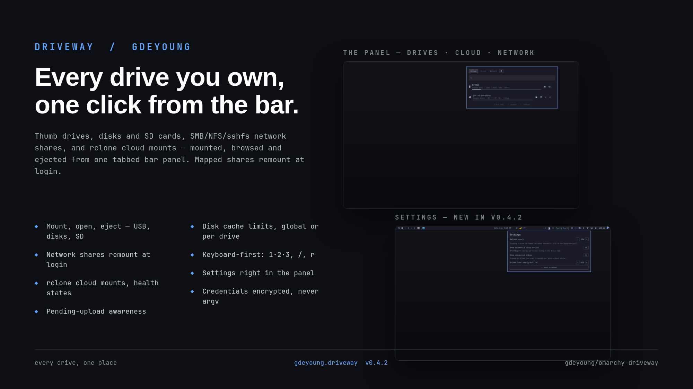

# Driveway



Every drive you own, one click from the bar — the old Mac volume
menu, rebuilt for Omarchy.

One bar icon opens a tabbed panel:

- **Drives** — the OG dropdown: a pinned read-only System row (the disk behind
  `/`), thumb drives, external/internal disks, SD cards, discs, disk images,
  network shares and rclone cloud mounts, all in one searchable list. Click a
  drive to open it in the file manager (mounting it first if needed); open a
  terminal at it; eject or power it off. Unmounting is refused while apps hold
  files open — with their names, and a "close apps & retry" that never touches
  the shell itself. LUKS volumes unlock in a terminal (passphrases never pass
  through the shell). Pending rclone uploads warn before an unmount.
- **Cloud** — rclone remotes (Google Drive, OneDrive, Dropbox, Nextcloud, S3,
  anything rclone speaks) on supervised systemd user units: mount/unmount,
  health states (`Mounted`, `Starting…`, `Stopped`, `Failed · retrying`,
  `Mounted (no unit)`), usage bars, pending-upload counts. The restart loop
  rides out dead networks; each mount gets a private 0700 rc socket. **Add
  cloud drive** runs the whole sign-in in the panel: Google/OneDrive/Dropbox
  OAuth opens your browser (`rclone authorize`, token captured over a pty,
  never logged, never in argv); Nextcloud/WebDAV/SFTP/FTP take a URL + login.
- **Network** — live SMB/NFS/sshfs/WebDAV mounts with open/terminal/unmount.
  **Map network drive** opens an in-panel wizard: browse the LAN (Avahi lists
  SMB/SSH/FTP servers, smbclient lists shares) or paste any
  `smb:// sftp:// ftp:// nfs:// dav://` address, with optional credentials.
  Mapped drives remount at login (`driveway-netmap.service`); credentials are
  stored encrypted (`systemd-creds --user`, 0600) and only ever cross a pipe,
  never argv. Guest mounts need no credentials.

## Requirements

- Omarchy (Quickshell bar), `python3`, `udisks2` (standard).
- Cloud tab: `rclone` (`sudo pacman -S rclone`) — the panel says so if missing.

## Install

```
omarchy plugin add https://github.com/gdeyoung/omarchy-driveway.git --enable
```

## Keyboard

`1`/`2`/`3` switch tabs · `←`/`→` cycle tabs · `/` search · `Esc` clear search
then close · `r` refresh. Right-click the bar icon to refresh.

## What the plugin runs

Every external command, for the security reviewer:

| Command | Why |
|---|---|
| `python3` (`bin/driveway`, stdlib only) | list/status/actions backend |
| `lsblk`, `findmnt`, `udevadm monitor` | block/volume enumeration + live events |
| `udisksctl mount/unmount/lock/unlock/power-off/loop-delete` | local disk actions (no root) |
| `fusermount3 -u [-z]`, `gio mount -u` | FUSE / gvfs unmounts |
| `rclone listremotes --long` | read remotes (never writes rclone config) |
| `systemctl --user show/start/stop/daemon-reload` | `driveway-cloud@.service` lifecycle |
| HTTP POST on a private unix socket | rclone rc `vfs/stats` (upload activity) |
| `xdg-open`, `foot --working-directory` | open in file manager / terminal |
| `omarchy-launch-floating-terminal-with-presentation` | LUKS unlock + `rclone config` |
| `notify-send -a Driveway` | action outcomes |
| `systemctl --user restart driveway-cloud@<name>` | apply cache-limit changes |

No secrets are stored by the plugin: credentials live in rclone's own config;
LUKS passphrases are typed straight into udisksctl's terminal prompt.

## Disk cache limits

Cached cloud files live in `~/.cache/rclone` (VFS cache, mode `full`).
A **global default** (10G) and **per-drive overrides** are editable from the
panel's Cloud tab (Disk cache button) and the CLI:

```
driveway cloud cache-get
driveway cloud cache-set global 10G
driveway cloud cache-set gdrive-gdeyoung 25G   # per-drive override
driveway cloud cache-set gdrive-gdeyoung off   # remove cap (not recommended)
```

Values are `SizeSuffix` (`500M`, `10G`, `1.5T`) or `off`. They ride
`EnvironmentFile`s (`~/.config/driveway/cloud-defaults.env`,
`~/.config/driveway/<remote>.env`) that the unit template reads; changing one
restarts the affected mount automatically.

## Settings (bar widget settings)

Gear button in the panel header. Refresh interval (`pollIntervalSec`, 10s),
show network & cloud drives (`showNetwork`), show unmounted drives
(`showUnmounted`), nearly-full threshold (`fullWarnPct`, 90%). Classifier
internals stay CLI/JSON-only: `thumbMaxGb` (256), `minUnmountedMb` (64) —
`omarchy bar set gdeyoung.driveway <key> <value>` for those.

## Development

```
node --test tests/test_model.mjs   # Model.js (pure logic)
python3 tests/test_driveway.py     # backend smoke tests
```

Source: `~/work/omarchy-driveway` → installed hot-reload clone at
`~/.config/omarchy/plugins/gdeyoung.driveway`.

## Credits

Vendored (MIT) with thanks — see NOTICE.md for module-level provenance:
jgarza9788/drives (enumeration + disk actions), bmaltais/StartDrive
(systemd unit pattern), jonspinks/omarchy-rclone (supervision model),
TiniTinyTerminator/ODrive and sjmaquina/netdrives (planned v0.2 vendors).
